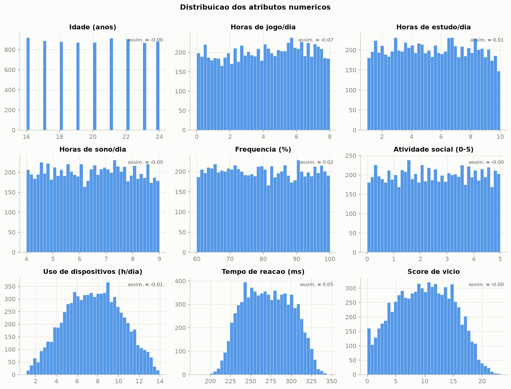
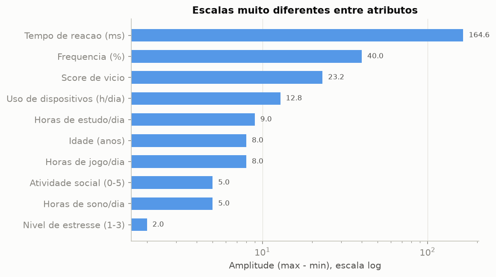
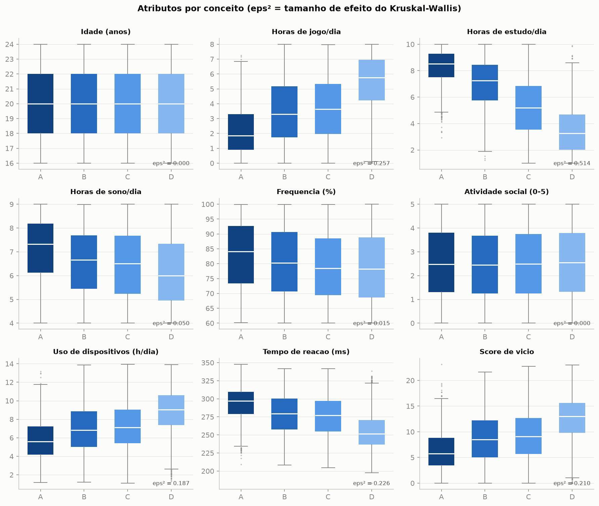
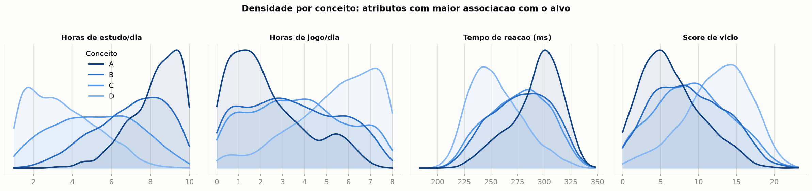
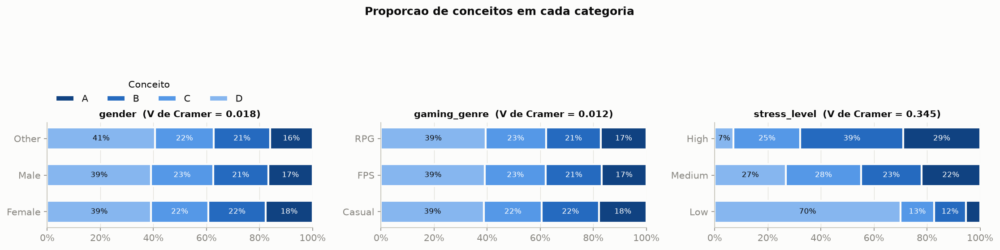
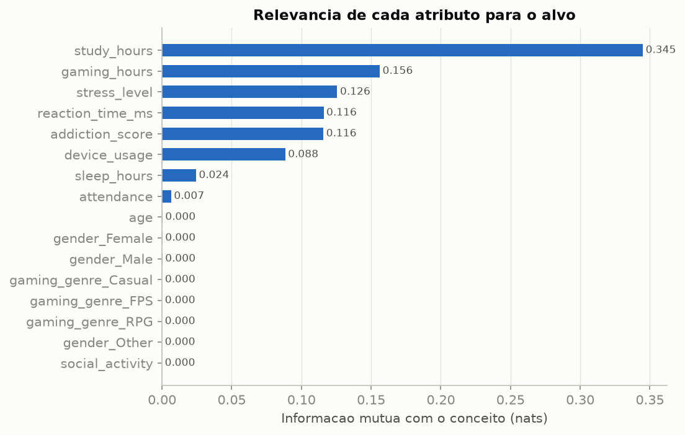
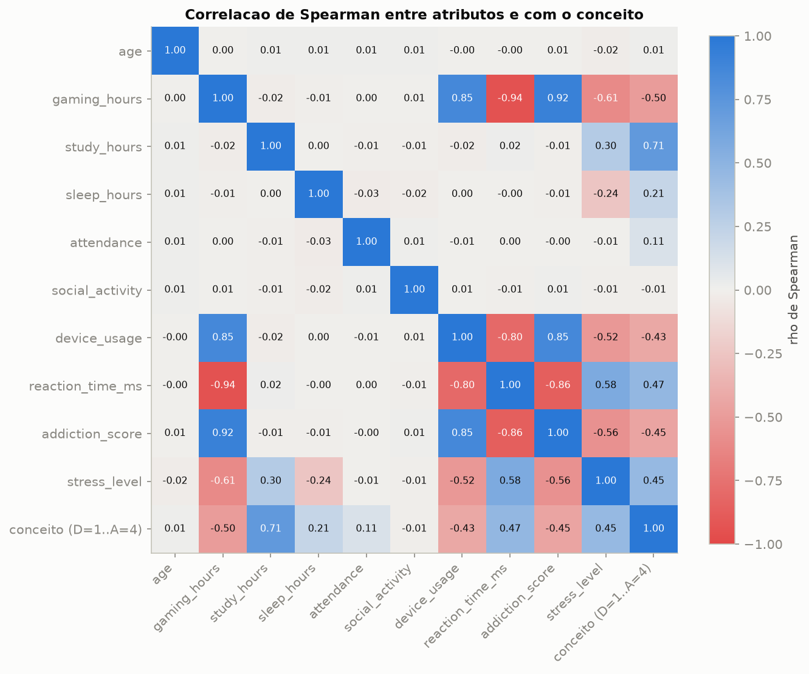
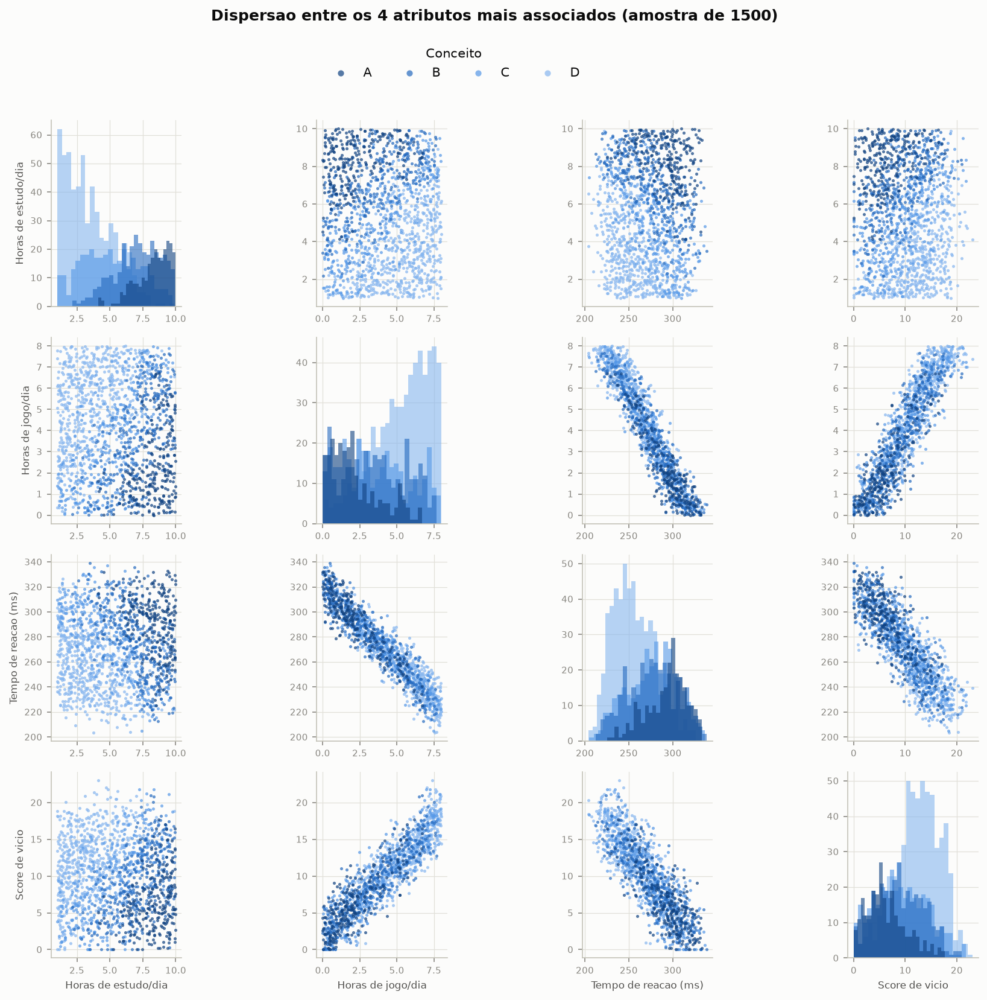
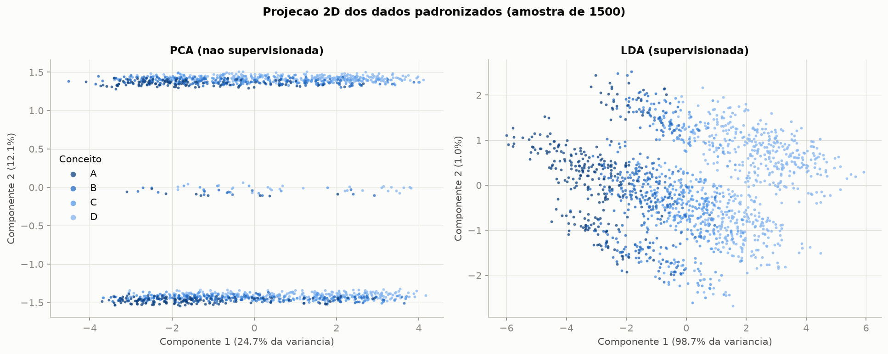
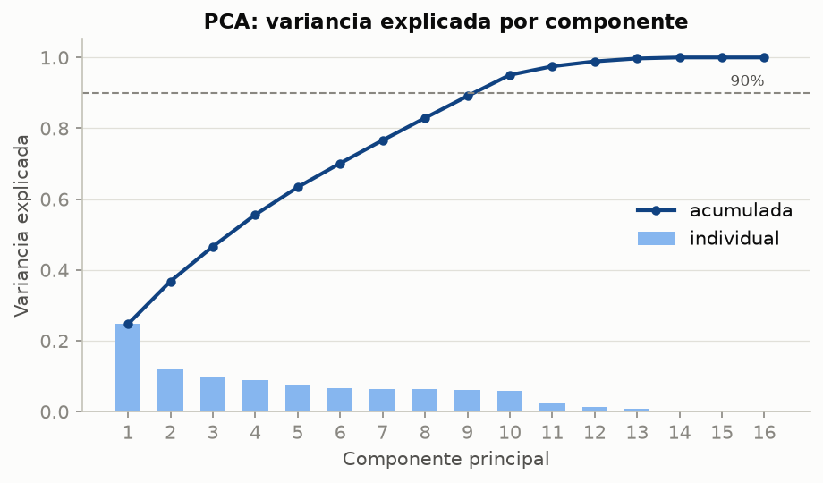

# Análise Exploratória dos Dados (EDA) — estado pós-processamento

Este documento descreve o conjunto de dados **no estado final usado pelos modelos** (`Gaming_Academic_Performance_limpo.csv`), isto é, depois de:

1. remover `student_id`;
2. limitar `grades` ao intervalo [0, 100] e `addiction_score` a valores ≥ 0;
3. converter `grades` no atributo alvo `conceito` (A ≥ 90, B ≥ 75, C ≥ 60, D < 60) e remover `grades` das entradas;
4. codificar `stress_level` como ordinal (Low=1, Medium=2, High=3) e aplicar One-Hot Encoding em `gender` e `gaming_genre`.

Quando é útil, ele também mostra dados do arquivo bruto para explicar os efeitos do pré-processamento. Todos os números e figuras são gerados por `eda/gerar_eda.py`, e os valores exatos ficam em `eda/resultados_eda.json`.

---

## 0. Resumo dos principais achados

| # | Achado | Consequência para a modelagem |
|---|---|---|
| 1 | 8000 instâncias, 16 atributos, sem valores faltantes, duplicatas ou outliers (regra 1,5·IQR) | Não é preciso remover instâncias |
| 2 | Classes levemente desbalanceadas (D = 39,1%, A = 17,2%) | Validação estratificada e F1 macro como métrica principal |
| 3 | **`study_hours` é de longe o atributo mais informativo** (ε² = 0,51; ρ = 0,72), seguido de `gaming_hours` | Os modelos devem se apoiar principalmente nesses dois atributos |
| 4 | **`gender`, `gaming_genre`, `age` e `social_activity` não têm associação com o conceito** (p > 0,3 em todos os testes) | São atributos irrelevantes. Prejudicam modelos baseados em distância (KNN) |
| 5 | **Bloco de atributos redundantes**: `gaming_hours`, `reaction_time_ms`, `addiction_score` e `device_usage` têm \|ρ\| entre 0,80 e 0,94 entre si (VIF de `gaming_hours` = 15) | Multicolinearidade. Na prática, os quatro carregam a mesma informação |
| 6 | **`stress_level` é quase uma função determinística** de `gaming_hours`, `study_hours` e `sleep_hours` (uma árvore de profundidade 3 o reconstrói com 99,95% de acerto) | Explica o efeito "contraintuitivo" (mais estresse → conceito melhor) e mostra que o atributo é derivado |
| 7 | A nota original é **quase linear** nos atributos (R² = 0,91 com regressão linear) e a LDA concentra **98,7% da separação entre classes em um único eixo** | O problema é essencialmente ordinal e unidimensional. Modelos lineares devem ir bem, e os erros devem se concentrar entre conceitos vizinhos |
| 8 | **41,7% dos conceitos A vêm de notas exatamente iguais a 100** (saturação causada pelo clip) | A classe A é um "acúmulo" no topo da escala |
| 9 | Escalas muito diferentes (amplitude de 2 a 165) | Normalização obrigatória para KNN, MLP, SVM e regressão logística |
| 10 | Distribuições uniformes (curtose ≈ −1,2) e regras exatas entre atributos | Fortes indícios de que o **dataset é sintético** |

---

## 1. Visão geral do conjunto de dados final

- **Instâncias:** 8000 (uma por estudante)
- **Atributos de entrada:** 16 (9 numéricos contínuos ou discretos, 1 ordinal e 6 binários do One-Hot)
- **Atributo alvo:** `conceito`, categórico ordinal com 4 classes (A, B, C, D)

### 1.1 Dicionário de dados original (antes do pré-processamento)

O arquivo bruto (`Gaming_Academic_Performance_updated.csv`) tem **8000 instâncias e 14 colunas**:

| Coluna | Tipo | Domínio observado | Valores distintos | Descrição | O que acontece no pré-processamento |
|---|---|---|---|---|---|
| `student_id` | inteiro (identificador) | 1 – 8000 | 8000 | Identificador único do estudante | **Removida** (não tem valor preditivo) |
| `age` | numérico discreto | 16 – 24 | 9 | Idade em anos | Mantida |
| `gender` | categórico nominal | Female, Male, Other | 3 | Gênero | **One-Hot** → `gender_Female`, `gender_Male`, `gender_Other` |
| `gaming_hours` | numérico contínuo | 0 – 8 | 801 | Horas de jogo por dia | Mantida |
| `study_hours` | numérico contínuo | 1 – 10 | 901 | Horas de estudo por dia | Mantida |
| `sleep_hours` | numérico contínuo | 4 – 9 | 501 | Horas de sono por dia | Mantida |
| `attendance` | numérico contínuo | 60 – 100 | 3472 | Frequência às aulas (%) | Mantida |
| `gaming_genre` | categórico nominal | Casual, FPS, RPG | 3 | Gênero de jogo preferido | **One-Hot** → `gaming_genre_Casual`, `gaming_genre_FPS`, `gaming_genre_RPG` |
| `social_activity` | numérico contínuo | 0 – 5 | 501 | Nível de atividade social | Mantida |
| `device_usage` | numérico contínuo | 1,10 – 13,95 | 1202 | Uso de dispositivos (h/dia) | Mantida |
| `reaction_time_ms` | numérico contínuo | 183,26 – 347,87 | 5660 | Tempo de reação (ms) | Mantida |
| `addiction_score` | numérico contínuo | **−4,51** – 23,16 | 2039 | Score de vício em jogos | **Limitada a ≥ 0** (107 valores negativos viram 0) |
| `stress_level` | categórico ordinal | Low, Medium, High | 3 | Nível de estresse | **Codificação ordinal** → 1, 2, 3 |
| `grades` | numérico contínuo | 0 – **118,63** | 5832 | Nota do estudante | **Limitada a [0, 100]**, convertida no alvo `conceito` e **removida das entradas** (vazamento do alvo) |

Em resumo: das 14 colunas originais, 1 é identificador, 1 é a nota (origem do alvo) e **12 são atributos preditivos** (9 numéricos, 2 nominais e 1 ordinal). Depois do One-Hot Encoding, os 12 atributos viram as **16 colunas de entrada** descritas a seguir.

### 1.2 Dicionário de atributos (após o pré-processamento)

| Atributo | Tipo | Domínio observado | Valores distintos | Descrição |
|---|---|---|---|---|
| `age` | numérico discreto | 16 – 24 | 9 | Idade em anos |
| `gaming_hours` | numérico contínuo | 0 – 8 | 801 | Horas de jogo por dia |
| `study_hours` | numérico contínuo | 1 – 10 | 901 | Horas de estudo por dia |
| `sleep_hours` | numérico contínuo | 4 – 9 | 501 | Horas de sono por dia |
| `attendance` | numérico contínuo | 60 – 100 | 3472 | Frequência às aulas (%) |
| `social_activity` | numérico contínuo | 0 – 5 | 501 | Nível de atividade social |
| `device_usage` | numérico contínuo | 1,10 – 13,95 | 1202 | Uso de dispositivos (h/dia) |
| `reaction_time_ms` | numérico contínuo | 183,26 – 347,87 | 5660 | Tempo de reação (ms) |
| `addiction_score` | numérico contínuo | 0 – 23,16 | 1955 | Score de vício em jogos |
| `stress_level` | ordinal | 1, 2, 3 | 3 | Low / Medium / High |
| `gender_Female`, `gender_Male`, `gender_Other` | binário (One-Hot) | 0 / 1 | 2 | Gênero |
| `gaming_genre_Casual`, `gaming_genre_FPS`, `gaming_genre_RPG` | binário (One-Hot) | 0 / 1 | 2 | Gênero de jogo preferido |
| **`conceito`** | **alvo ordinal** | A, B, C, D | 4 | Derivado de `grades` |

Os atributos contínuos têm resolução de 0,01, o que explica os números redondos de valores distintos (por exemplo, 501 valores entre 4 e 9 horas de sono).

### 1.3 Estatísticas descritivas

| Atributo | Média | Desvio | Mín | Q1 | Mediana | Q3 | Máx | Assimetria | Curtose |
|---|---|---|---|---|---|---|---|---|---|
| age | 19,98 | 2,59 | 16 | 18 | 20 | 22 | 24 | 0,00 | −1,23 |
| gaming_hours | 4,08 | 2,30 | 0 | 2,13 | 4,13 | 6,04 | 8 | −0,07 | −1,19 |
| study_hours | 5,45 | 2,56 | 1 | 3,24 | 5,46 | 7,64 | 10 | 0,01 | −1,19 |
| sleep_hours | 6,48 | 1,43 | 4 | 5,24 | 6,50 | 7,69 | 9 | 0,00 | −1,19 |
| attendance | 79,89 | 11,58 | 60 | 69,78 | 79,70 | 90,10 | 100 | 0,02 | −1,21 |
| social_activity | 2,51 | 1,44 | 0 | 1,29 | 2,50 | 3,76 | 5 | 0,00 | −1,20 |
| device_usage | 7,59 | 2,71 | 1,10 | 5,56 | 7,61 | 9,60 | 13,95 | −0,01 | −0,69 |
| reaction_time_ms | 271,11 | 29,44 | 183,26 | 247,16 | 270,48 | 294,69 | 347,87 | 0,05 | −0,92 |
| addiction_score | 9,92 | 5,01 | 0 | 5,92 | 10,01 | 13,86 | 23,16 | 0,00 | −0,85 |
| stress_level | 1,78 | 0,65 | 1 | 1 | 2 | 2 | 3 | 0,25 | −0,72 |

### 1.4 Frequência dos atributos categóricos

| Atributo | Categoria | Instâncias | % |
|---|---|---|---|
| gender | Male | 3904 | 48,8% |
| | Female | 3803 | 47,5% |
| | Other | 293 | 3,7% |
| gaming_genre | FPS | 3187 | 39,8% |
| | RPG | 2408 | 30,1% |
| | Casual | 2405 | 30,1% |
| stress_level | Low (1) | 2743 | 34,3% |
| | Medium (2) | 4247 | 53,1% |
| | High (3) | 1010 | 12,6% |

A categoria `gender = Other` é rara (3,7%). Se `gender` fosse relevante, isso poderia ser um problema, mas a Seção 5.3 mostra que não é.

---

## 2. Qualidade e consistência dos dados

### 2.1 Valores faltantes, duplicatas e outliers

- **Valores faltantes:** 0.
- **Instâncias duplicadas:** 0, considerando só os atributos ou atributos + alvo.
- **Outliers pela regra de 1,5·IQR:** **nenhum** em nenhum dos 9 atributos numéricos. As distribuições são limitadas, sem caudas longas (Seção 4), então não sobram valores extremos depois do pré-processamento.

### 2.2 Coerência de domínio

- **Soma de horas:** `gaming_hours + study_hours + sleep_hours` nunca passa de 24 (máximo = 23 h). Nenhuma instância é fisicamente impossível nesse aspecto.
- **Frequência:** fica entre 60% e 100%, dentro do domínio válido. Não existe nenhum aluno com frequência abaixo de 60%, o que é um corte artificial do gerador dos dados.
- **Idade:** entre 16 e 24 anos, compatível com estudantes de ensino médio e graduação.

### 2.3 Efeitos do pré-processamento

| Problema no dado bruto | Tratamento | Efeito no dado final |
|---|---|---|
| 134 notas acima de 100 (máx. 118,63) | `clip(0, 100)` | Somadas às notas que já eram 100, **573 notas ficam exatamente em 100**. Isso equivale a **41,7% dos conceitos A** |
| 1 nota igual a 0 | mantida | 1 instância em D |
| 107 valores negativos em `addiction_score` (mín. −4,51) | `clip(lower=0)` | **108 instâncias com `addiction_score = 0`**, um pico visível no histograma (Figura 3) |

O clip das notas **não muda nenhum conceito**: uma nota acima de 100 cairia em A de qualquer jeito. A correção serve para a coerência do dado e para uma eventual regressão no T2.

---

## 3. Atributo alvo


**Figura 1 — Distribuição do conceito.**

| Conceito | Faixa de nota | Instâncias | % |
|---|---|---|---|
| A | ≥ 90 | 1375 | 17,2% |
| B | 75 – 90 | 1690 | 21,1% |
| C | 60 – 75 | 1804 | 22,6% |
| D | < 60 | 3131 | 39,1% |

- A classe majoritária (D) é **2,3 vezes** maior que a minoritária (A). O desbalanceamento é **leve**: nenhuma classe tem menos de 15% das instâncias. Por isso optamos por **não reamostrar** e usar validação cruzada estratificada com F1 macro.
- D concentra muitos alunos porque cobre a faixa mais larga da escala (60 pontos, contra 15 de B e C).
- **Baseline trivial:** um classificador que sempre prevê D tem **acurácia de 39,1%** e **F1 macro de 0,14**. Qualquer modelo útil precisa ficar bem acima desses valores. A acurácia sozinha seria enganosa.


**Figura 2 — Nota original (após o clip) e os cortes dos conceitos.** A nota tem distribuição assimétrica à esquerda, com cauda longa em direção a 0, e um **acúmulo em 100** causado pela saturação. Entre 50 e 100 a densidade é quase constante, então B e C (faixas de 15 pontos) ficam com tamanhos parecidos.

---

## 4. Distribuição dos atributos (análise univariada)



**Figura 3 — Histogramas dos atributos numéricos.**

- **`age`, `gaming_hours`, `study_hours`, `sleep_hours`, `attendance` e `social_activity` têm distribuição praticamente uniforme**: histogramas planos, assimetria ≈ 0 e curtose ≈ −1,2, que é exatamente a curtose de uma distribuição uniforme. Variáveis comportamentais reais raramente se distribuem assim, o que **indica que o dataset é sintético**.
- **`device_usage`, `reaction_time_ms` e `addiction_score` têm forma de sino ou trapézio** (curtose entre −0,9 e −0,7). Esse é o formato esperado de uma variável **calculada a partir de outra uniforme mais um ruído**. A Seção 6 confirma que as três dependem de `gaming_hours`.
- `addiction_score` tem um pequeno pico em 0, efeito do clip (Seção 2.3).
- Nenhuma distribuição tem assimetria relevante (|assimetria| < 0,1), então **não é preciso aplicar transformações como log**.

### 4.1 Escalas



**Figura 4 — Amplitude de cada atributo (escala log).** As amplitudes variam de 2 (`stress_level`) a 164,6 (`reaction_time_ms`). Sem normalização, `reaction_time_ms` e `attendance` dominariam qualquer distância euclidiana. Isso justifica o `StandardScaler` dentro do `Pipeline` para KNN, MLP, SVM e regressão logística. Árvores e Random Forest não dependem de escala.

---

## 5. Relação dos atributos com o conceito (análise bivariada)

### 5.1 Médias por conceito

| Atributo | A | B | C | D | Tendência de A → D |
|---|---|---|---|---|---|
| study_hours | **8,28** | 7,00 | 5,20 | **3,51** | ↓ forte |
| gaming_hours | **2,28** | 3,46 | 3,71 | **5,41** | ↑ forte |
| device_usage | 5,78 | 6,97 | 7,26 | 8,90 | ↑ |
| addiction_score | 6,42 | 8,73 | 9,21 | 12,51 | ↑ |
| reaction_time_ms | 292,5 | 278,5 | 275,6 | 255,2 | ↓ |
| stress_level | 2,11 | 2,04 | 1,95 | 1,41 | ↓ |
| sleep_hours | 7,09 | 6,58 | 6,47 | 6,17 | ↓ fraca |
| attendance | 82,8 | 80,4 | 79,1 | 78,8 | ↓ fraca |
| age | 20,06 | 20,02 | 19,90 | 19,98 | — |
| social_activity | 2,51 | 2,47 | 2,49 | 2,54 | — |

O padrão é coerente: alunos com conceito melhor **estudam mais, jogam menos, dormem mais e frequentam mais as aulas**. Um tempo de reação maior (reflexos mais lentos) acompanha conceitos melhores porque reflete menos horas de jogo (Seção 6).

### 5.2 Tamanho do efeito e significância

Como as distribuições não são normais (Seção 4), usamos **testes não paramétricos**:

- **Kruskal–Wallis**, com tamanho de efeito **ε²** (0,01 pequeno, 0,08 médio, ≥ 0,26 grande), para comparar as distribuições entre os 4 conceitos;
- **correlação de Spearman (ρ)** com o conceito codificado como ordinal (D=1 … A=4);
- **informação mútua (MI)**, que também captura relações não lineares.

| Atributo | H (Kruskal) | p-valor | ε² | ρ Spearman | MI | Leitura |
|---|---|---|---|---|---|---|
| study_hours | 4111,4 | < 10⁻³⁰⁰ | **0,514** | **+0,715** | **0,345** | efeito muito grande |
| gaming_hours | 2058,3 | < 10⁻³⁰⁰ | 0,257 | −0,498 | 0,156 | grande |
| stress_level | 1809,0 | < 10⁻³⁰⁰ | 0,226 | +0,450 | 0,126 | médio/grande (derivado, ver Seção 6.2) |
| reaction_time_ms | 1808,1 | < 10⁻³⁰⁰ | 0,226 | +0,466 | 0,116 | médio/grande (proxy de jogo) |
| addiction_score | 1679,5 | < 10⁻³⁰⁰ | 0,210 | −0,449 | 0,116 | médio/grande (proxy de jogo) |
| device_usage | 1496,7 | < 10⁻³⁰⁰ | 0,187 | −0,425 | 0,088 | médio/grande (proxy de jogo) |
| sleep_hours | 401,5 | 10⁻⁸⁶ | 0,050 | +0,214 | 0,024 | pequeno |
| attendance | 123,9 | 10⁻²⁶ | 0,015 | +0,113 | 0,007 | muito pequeno |
| age | 3,5 | 0,318 | 0,000 | +0,010 | 0,000 | **nenhum** |
| social_activity | 3,1 | 0,381 | 0,000 | −0,014 | 0,000 | **nenhum** |



**Figura 5 — Boxplots de cada atributo numérico por conceito.** As caixas de `study_hours` quase não se sobrepõem entre A e D, enquanto as de `age` e `social_activity` são idênticas nos quatro conceitos.



**Figura 6 — Densidade por conceito dos 4 atributos mais associados.** Os conceitos extremos (A e D) se separam bem, mas **B e C se sobrepõem quase totalmente** em todos os atributos. Já dá para prever que a maior dificuldade dos modelos será distinguir as classes intermediárias.

### 5.3 Atributos categóricos



**Figura 7 — Proporção de conceitos em cada categoria.** Usamos o teste χ² de independência, com **V de Cramér** como tamanho de efeito (0,1 pequeno, 0,3 médio, 0,5 grande).

| Atributo | χ² | p-valor | V de Cramér | Leitura |
|---|---|---|---|---|
| gender | 5,2 | 0,523 | 0,018 | **independente do conceito** |
| gaming_genre | 2,4 | 0,876 | 0,012 | **independente do conceito** |
| stress_level | 1908,3 | < 10⁻³⁰⁰ | 0,345 | associação média |

- Em `gender` e `gaming_genre`, **todas as categorias têm praticamente a mesma distribuição de conceitos** (≈ 39% D, 22% C, 21% B, 17% A). Ou seja, o gênero do aluno e o tipo de jogo que ele prefere não dizem nada sobre o conceito.
- Em `stress_level` o efeito é forte e **contraintuitivo**: 70% dos alunos com estresse **baixo** ficam com D, enquanto só 7% dos alunos com estresse **alto** ficam com D. A Seção 6.2 explica por quê.

### 5.4 Ranking de relevância



**Figura 8 — Informação mútua de cada atributo com o conceito.** Os atributos se dividem em três grupos:

1. **Relevantes:** `study_hours` (sozinho tem mais que o dobro da MI do segundo colocado), `gaming_hours`, `stress_level`, `reaction_time_ms`, `addiction_score` e `device_usage`;
2. **Pouco relevantes:** `sleep_hours` e `attendance`;
3. **Irrelevantes (MI ≈ 0):** `age`, `social_activity` e os 6 binários de `gender` e `gaming_genre`.

Isso significa que **8 dos 16 atributos de entrada não carregam informação sobre o alvo**. Para o KNN isso é especialmente ruim: depois da normalização, cada atributo irrelevante contribui para a distância com o mesmo peso dos relevantes, o que esconde a estrutura real dos dados. Isso ajuda a explicar o desempenho mais baixo do KNN no spot-checking. Seleção de atributos é um candidato natural para o T2.

---

## 6. Relações entre atributos



**Figura 9 — Correlação de Spearman entre os atributos e com o conceito.**

### 6.1 O bloco "jogo" e a multicolinearidade

| Par de atributos | ρ Spearman |
|---|---|
| gaming_hours × reaction_time_ms | −0,943 |
| gaming_hours × addiction_score | +0,916 |
| reaction_time_ms × addiction_score | −0,862 |
| device_usage × addiction_score | +0,854 |
| gaming_hours × device_usage | +0,853 |
| device_usage × reaction_time_ms | −0,801 |
| gaming_hours × stress_level | −0,607 |
| reaction_time_ms × stress_level | +0,577 |

**Fator de inflação da variância (VIF)**, que mede quanto cada atributo é explicado pelos demais (VIF > 5 indica multicolinearidade preocupante, > 10 grave):

| gaming_hours | reaction_time_ms | addiction_score | device_usage | stress_level | study_hours | sleep_hours | age, attendance, social_activity |
|---|---|---|---|---|---|---|---|
| **14,97** | **8,46** | **6,60** | 4,04 | 1,93 | 1,20 | 1,15 | 1,00 |



**Figura 10 — Matriz de dispersão dos 4 atributos mais associados (amostra de 1500 alunos).** As relações entre `gaming_hours`, `reaction_time_ms` e `addiction_score` são **quase retas**: uma variável é praticamente uma transformação linear da outra mais ruído. Já `study_hours` é **independente** de todas as outras (nuvem sem forma nos painéis da primeira linha).

Interpretação:

- `reaction_time_ms`, `addiction_score` e `device_usage` são **proxies de `gaming_hours`**. A associação delas com o conceito (Seção 5.2) é em grande parte **herdada** do tempo de jogo. Na LDA (Seção 7), elas recebem peso quase nulo (|coeficiente| < 0,01) quando `gaming_hours` está presente.
- Isso afeta os modelos de formas diferentes: a **regressão logística** fica com coeficientes instáveis (difíceis de interpretar, embora a previsão funcione); o **Naive Bayes** viola sua hipótese de independência e "conta várias vezes" a mesma evidência; o **KNN** dá peso 4× maior à dimensão "jogo" na distância. Árvores e Random Forest são pouco afetados.
- Os atributos que parecem "originais" (`study_hours`, `sleep_hours`, `attendance`, `age`, `social_activity`) são **mutuamente independentes** (|ρ| ≤ 0,03 entre si).
- Há também uma **dependência linear exata** nas colunas One-Hot: `gender_Female + gender_Male + gender_Other = 1`, e o mesmo vale para `gaming_genre`. Isso aparece na PCA como dois componentes de variância zero (Figura 12). É inofensivo para os modelos regularizados do scikit-learn, mas vale registrar.

### 6.2 O caso `stress_level`: um atributo derivado

O resultado "mais estresse → conceito melhor" (Seção 5.3) chamou a atenção, então investigamos. Uma **árvore de decisão de profundidade 3**, treinada para prever `stress_level` a partir dos demais atributos, acerta **99,95%** (4 erros em 8000), com as regras:

```
se study_hours > 7 e sleep_hours ≤ 6     → High
senão, se gaming_hours > 5               → Low
senão                                    → Medium
```

Ou seja, **o nível de estresse foi gerado por uma regra** a partir de horas de estudo, sono e jogo. Isso explica as observações anteriores:

- **Low** = alunos que jogam mais de 5 h/dia. Como jogar muito está associado a notas baixas, 70% deles ficam com D.
- **High** = alunos que estudam mais de 7 h/dia e dormem pouco. Como estudar muito está associado a notas altas, só 7% deles ficam com D.
- A média de horas de estudo é 4,96 h com estresse Low, 5,05 h com Medium e **8,45 h com High**.

Portanto **o estresse não causa a nota**: ele é um resumo de atributos que já estão nos dados. Para o spot-checking isso não é um problema de vazamento (não envolve `grades`), mas é mais um atributo redundante. Também é a **principal ressalva sobre o realismo do dataset**: conclusões do tipo "estresse melhora o desempenho" não devem ser tiradas desses dados.

---

## 7. Estrutura global e separabilidade das classes



**Figura 11 — Projeções 2D dos dados padronizados.**

- **PCA (não supervisionada, à esquerda):** o 1º componente (24,7% da variância) é o **bloco "jogo"**, com cargas ≈ 0,47 em `gaming_hours`, `addiction_score`, `reaction_time_ms` e `device_usage`. O 2º componente (12,1%) só separa **o gênero** (as três faixas horizontais são Female, Other e Male). Como o gênero é irrelevante para o alvo, a 2ª direção de maior variância dos dados não tem relação com o conceito. As classes aparecem ordenadas ao longo do eixo 1, mas misturadas.
- **LDA (supervisionada, à direita):** o 1º discriminante concentra **98,7%** da separação entre classes, e o 2º só 1,0%. Os conceitos se organizam **em ordem (A → B → C → D) ao longo de um único eixo**, que é basicamente `−1,77·study_hours + 1,22·gaming_hours − 0,54·sleep_hours − 0,32·attendance` (dados padronizados).



**Figura 12 — Variância explicada pela PCA.** São necessários **10 dos 16 componentes** para explicar 90% da variância. Os dados não têm dimensão intrínseca baixa no sentido não supervisionado, porque a maior parte dos atributos é ruído independente e uniforme. Os 2 últimos componentes têm variância zero por causa do One-Hot (Seção 6.1).

### 7.1 O que isso diz sobre a dificuldade do problema

- Uma **regressão linear** da nota original sobre os 16 atributos explica **91% da variância** (R² = 0,911; 0,906 sem as notas saturadas em 100; medido no próprio conjunto, só como diagnóstico). A nota é, portanto, **quase uma combinação linear** de horas de estudo, jogo, sono e frequência mais um ruído.
- Ao transformar a nota em 4 faixas, esse ruído faz alunos próximos de um corte (60, 75 ou 90) caírem em qualquer um dos lados. **A maior parte dos erros de classificação deve acontecer entre conceitos vizinhos** (A↔B, B↔C, C↔D), o que as matrizes de confusão do spot-checking podem confirmar.
- Como a fronteira entre classes é essencialmente **linear e ordenada**, é razoável esperar que **modelos lineares (regressão logística, LDA) tenham desempenho competitivo ou superior** ao de modelos mais flexíveis, e que o KNN, prejudicado pelos 8 atributos irrelevantes, fique para trás.

---

## 8. Implicações para a modelagem

1. **Abordagem:** classificação multiclasse com classes ordinais. As métricas usadas (F1 macro etc.) tratam um erro A→D igual a um erro A→B, o que é uma limitação a registrar.
2. **Avaliação:** validação cruzada **estratificada** e F1 macro como métrica principal, pelo desbalanceamento leve. O baseline majoritário (F1 macro = 0,14) serve de referência mínima.
3. **Normalização:** obrigatória para KNN, MLP, SVM e regressão logística, sempre **dentro do `Pipeline`** para não vazar estatísticas do teste. Dispensável para árvores e Random Forest.
4. **Sem reamostragem e sem remoção de outliers:** não há outliers, e o desbalanceamento não justifica oversampling ou undersampling.
5. **Atributos irrelevantes** (`age`, `social_activity`, `gender_*`, `gaming_genre_*`): mantidos no T1, porque o spot-checking usa os dados como estão. São os primeiros candidatos à **seleção de atributos no T2**, especialmente para o KNN.
6. **Atributos redundantes** (bloco "jogo" e `stress_level`): afetam a interpretação de modelos lineares e a hipótese do Naive Bayes. Vale considerar isso ao interpretar o desempenho desses algoritmos.
7. **Diversidade de algoritmos:** a estrutura quase linear dos dados torna importante incluir **pelo menos um modelo linear** (regressão logística ou LDA) no spot-checking, para comparar com os não lineares (KNN, Random Forest, MLP).

---

## 9. Reprodutibilidade

- Script: `eda/gerar_eda.py` (lê `Gaming_Academic_Performance_updated.csv` e `Gaming_Academic_Performance_limpo.csv`, gera `eda/figs/*.png` e `eda/resultados_eda.json`).
- Seed: 42 (amostragem dos gráficos de dispersão e informação mútua).
- Dependências: pandas, numpy, matplotlib, scipy, scikit-learn.
- O enunciado exige que todas as etapas estejam no notebook do Colab, então **o código deste script deve ser copiado para a seção de EDA do notebook** antes da entrega.
