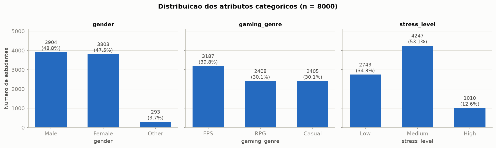
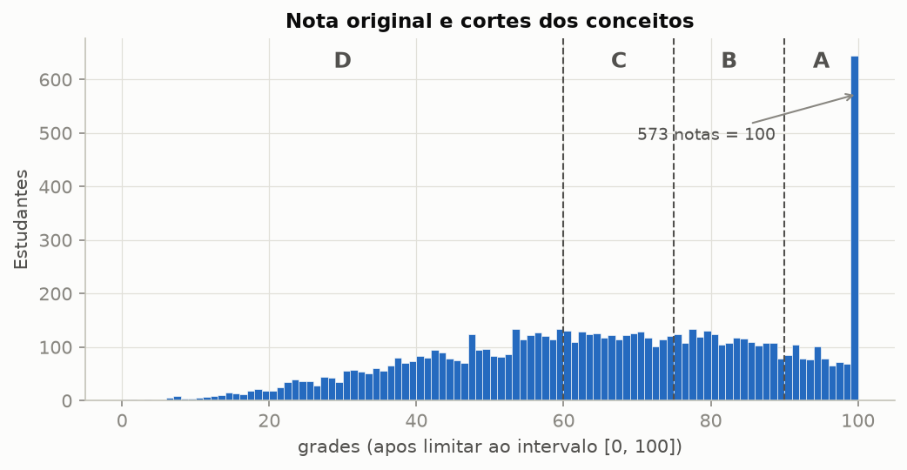
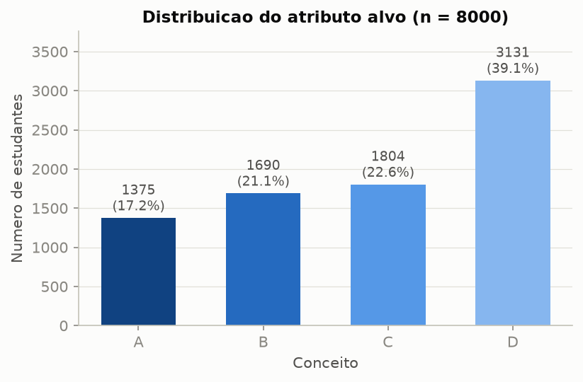

# Resumo da EDA

Resumo das análises principais de `eda/EDA.md`, calculadas sobre o conjunto final (`Gaming_Academic_Performance_limpo.csv`, 8000 instâncias, sem valores faltantes). As frequências dos atributos categóricos usam as categorias originais (antes do One-Hot e da codificação ordinal). As exceções são `addiction_score` e `grades`, analisados no estado do CSV bruto (`Gaming_Academic_Performance_updated.csv`), antes do clip.

---

## 1. Distribuição das classes dos atributos categóricos

| Atributo | Categoria | Instâncias | % |
|---|---|---|---|
| **gender** | Male | 3904 | 48,8% |
| | Female | 3803 | 47,5% |
| | Other | 293 | 3,7% |
| **gaming_genre** | FPS | 3187 | 39,8% |
| | RPG | 2408 | 30,1% |
| | Casual | 2405 | 30,1% |
| **stress_level** | Low (1) | 2743 | 34,3% |
| | Medium (2) | 4247 | 53,1% |
| | High (3) | 1010 | 12,6% |

- `gender` está equilibrado entre Male e Female; a categoria `Other` é rara (3,7%).
- `gaming_genre` tem FPS um pouco mais frequente; RPG e Casual estão empatados.
- `stress_level` concentra mais da metade das instâncias em Medium, e High é a categoria menos frequente (12,6%).

---

## 2. Estatísticas descritivas dos atributos numéricos

| Atributo | Média | Desvio padrão | Mínimo | Mediana | Máximo |
|---|---|---|---|---|---|
| age | 19,98 | 2,59 | 16 | 20 | 24 |
| gaming_hours | 4,08 | 2,30 | 0 | 4,13 | 8 |
| study_hours | 5,45 | 2,56 | 1 | 5,46 | 10 |
| sleep_hours | 6,48 | 1,43 | 4 | 6,50 | 9 |
| attendance | 79,89 | 11,58 | 60 | 79,70 | 100 |
| social_activity | 2,51 | 1,44 | 0 | 2,50 | 5 |
| device_usage | 7,59 | 2,71 | 1,10 | 7,61 | 13,95 |
| reaction_time_ms | 271,11 | 29,44 | 183,26 | 270,48 | 347,87 |
| addiction_score\* | 9,91 | 5,04 | −4,51 | 10,01 | 23,16 |

\* `addiction_score` está no estado do CSV bruto, **sem o clip** em 0 aplicado no pré-processamento (ver Seção 2.1). No conjunto usado pelos modelos as estatísticas ficam: média 9,92, desvio 5,01, mínimo 0, mediana 10,01, máximo 23,16.

- Em todos os atributos a média e a mediana são praticamente iguais, ou seja, as distribuições são simétricas (sem caudas longas).
- As escalas são muito diferentes (de 0–5 em `social_activity` a 183–348 em `reaction_time_ms`), por isso os modelos baseados em distância ou gradiente usam `StandardScaler` dentro do `Pipeline`.

### 2.1 Por que limitamos `addiction_score` a valores ≥ 0

O CSV bruto tem **107 instâncias (1,3%) com `addiction_score` negativo**, entre −4,51 e −0,02 (mediana −0,76).

**O valor negativo é um erro de domínio, não uma informação.** Um score de vício mede intensidade: o menor valor com sentido é "nenhum vício" (0). Não existe "vício negativo", então esses valores não podem ser lidos literalmente.

**A origem do erro é visível nos dados.** O `addiction_score` é quase uma função linear do tempo de jogo, aproximadamente `2·gaming_hours + 1,8` mais um ruído com desvio de ~2,1. Os 107 alunos com valor negativo jogam em média só **0,47 h/dia** (máximo 1,96 h), contra 4,08 h/dia no conjunto todo. Para quem quase não joga, o valor esperado do score fica perto de 0, e o ruído do gerador do dataset joga parte deles para baixo de zero. Ou seja, são alunos com vício próximo de zero, e o clip devolve exatamente esse significado.

**Por que clip e não outra alternativa:**

| Alternativa | Problema |
|---|---|
| Remover as 107 instâncias | Perde dados e **enviesa a classe A**: 39 dos 107 alunos são A (36%, contra 17% no conjunto todo), justamente a classe minoritária |
| Manter os negativos | Deixa valores impossíveis no domínio e mistura erro do gerador com informação |
| Tratar como faltante e imputar | Complexo demais para o tamanho do problema e substituiria o valor pela média (~9,9), que é muito pior para alunos que quase não jogam |
| **Limitar a 0 (escolhida)** | Mantém as 8000 instâncias, preserva a ordem (quem tinha score baixo continua com o menor score) e dá um valor coerente com o domínio |

**Impacto:** pequeno. O mínimo passa de −4,51 para 0, a média sobe só 0,01 e 108 alunos ficam com score exatamente 0 (os 107 corrigidos + 1 que já era 0), o que aparece como um pequeno pico em 0 no histograma. Para árvores e Random Forest o efeito é praticamente nulo, porque a ordem dos valores quase não muda. A justificativa é a mesma do clip de `grades` em [0, 100]: corrigir valores impossíveis sem descartar instâncias.

---

## 3. Análise da nota original (`grades`)

`grades` não entra nos modelos (é a origem do alvo e seria vazamento), mas é dela que o `conceito` é derivado. Os valores abaixo são do CSV bruto.

| Estatística | Bruto | Após clip [0, 100] |
|---|---|---|
| Média | 66,18 | 66,08 |
| Desvio padrão | 22,42 | 22,25 |
| Mínimo | 0 | 0 |
| Q1 | 49,88 | 49,88 |
| Mediana | 67,07 | 67,07 |
| Q3 | 83,99 | 83,99 |
| Máximo | **118,63** | 100 |
| Assimetria | −0,25 | — |

**Distribuição.** A nota tem leve assimetria à esquerda: a densidade é quase constante entre 50 e 100, e há uma cauda que desce até 0 (162 alunos com nota abaixo de 20). Não há outliers pela regra de 1,5·IQR.

**Problemas de domínio.**
- **134 notas acima de 100** (máximo 118,63), fora da escala válida. No pré-processamento elas são limitadas a 100.
- Já existiam **439 notas exatamente iguais a 100**. Somadas às 134 limitadas, **573 alunos ficam com nota 100**, o que corresponde a **41,7% de todos os conceitos A**. A classe A é, em boa parte, um acúmulo no teto da escala.
- Há 1 nota igual a 0 e nenhuma negativa.
- O clip **não muda nenhum conceito**: uma nota acima de 100 seria A de qualquer forma.

**Relação com os atributos** (correlação de Pearson com a nota bruta):

| Atributo | r | Atributo | r |
|---|---|---|---|
| study_hours | **+0,73** | sleep_hours | +0,25 |
| gaming_hours | **−0,56** | attendance | +0,13 |
| reaction_time_ms | +0,52 | social_activity | −0,02 |
| addiction_score | −0,50 | age | +0,01 |
| device_usage | −0,47 | | |

A média da nota também varia muito com o estresse (Low 50,6; Medium 72,7; High 81,0) e quase nada com o gênero (Female 66,6; Male 65,9; Other 65,3). Horas de estudo e de jogo são os principais fatores ligados à nota, e as mesmas relações aparecem depois com o `conceito`.

**Da nota para o conceito.** Os cortes em 60, 75 e 90 criam faixas de larguras diferentes. D cobre 60 pontos (0–60) e reúne 3131 alunos, enquanto B e C cobrem 15 pontos cada. Isso explica por que D é a maior classe na seção seguinte.

---

## 4. Distribuição das classes do atributo alvo (`conceito`)

| Conceito | Faixa de nota | Instâncias | % |
|---|---|---|---|
| A | ≥ 90 | 1375 | 17,2% |
| B | 75 – 90 | 1690 | 21,1% |
| C | 60 – 75 | 1804 | 22,6% |
| D | < 60 | 3131 | 39,1% |

- A classe majoritária (D) é 2,3 vezes maior que a minoritária (A). O desbalanceamento é **leve**: nenhuma classe tem menos de 15% das instâncias.
- D é a maior classe porque cobre a faixa mais larga de notas (60 pontos, contra 15 de B e C).
- Um classificador que sempre prevê D teria 39,1% de acurácia e F1 macro de 0,14. Por isso usamos validação cruzada **estratificada** e **F1 macro** como métrica principal, sem reamostragem.
